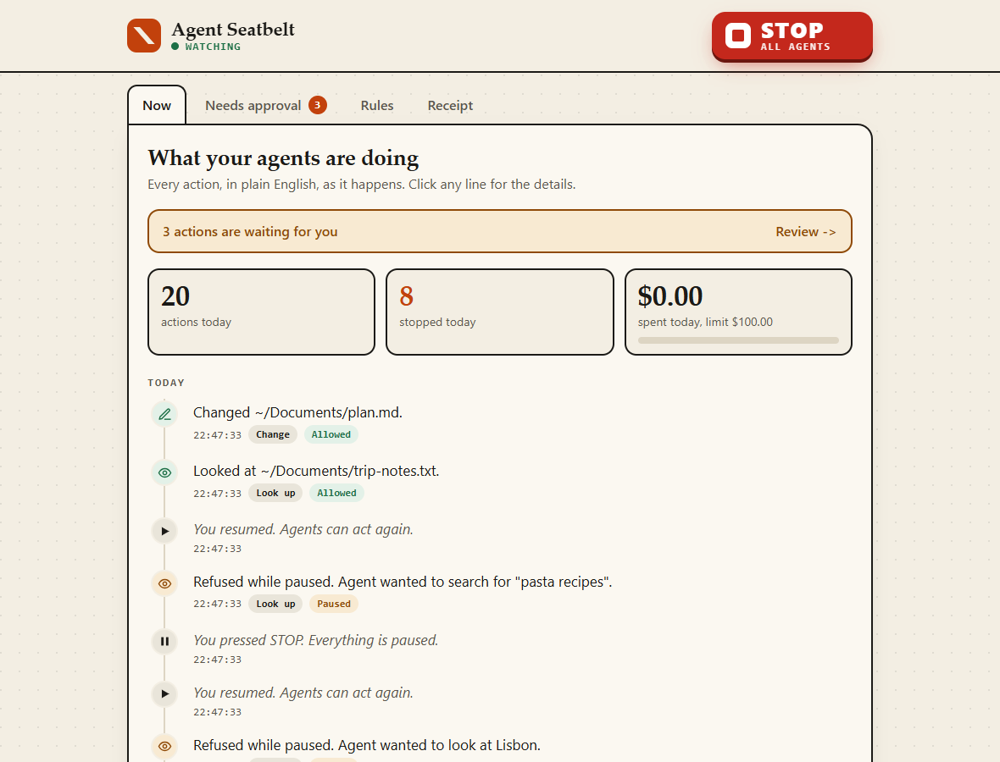
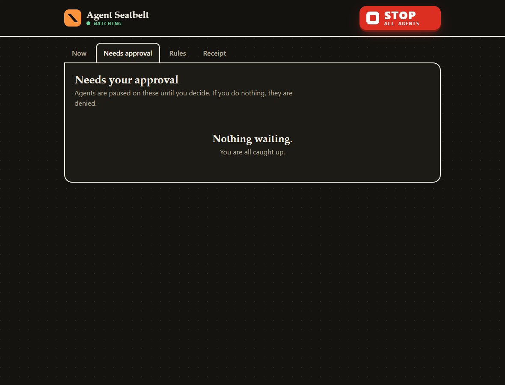
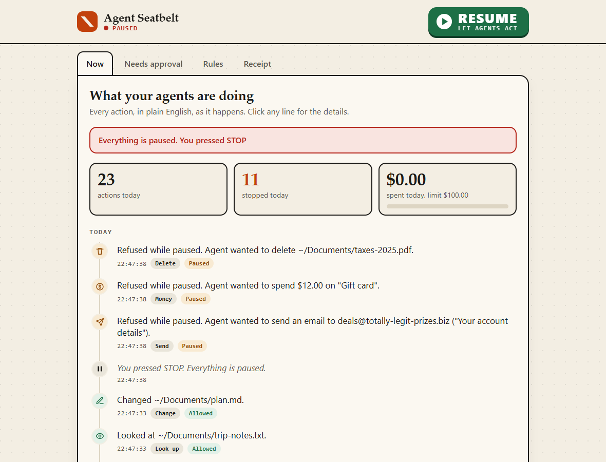
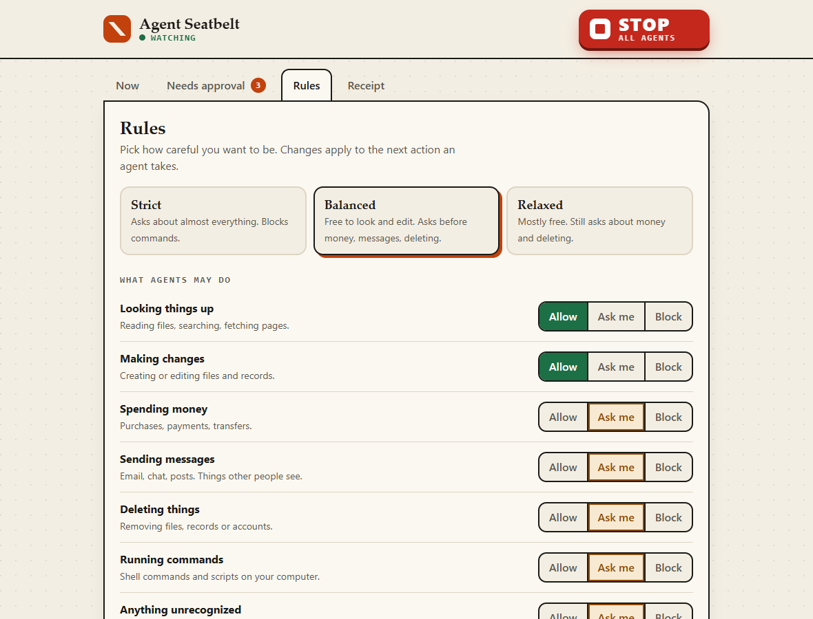
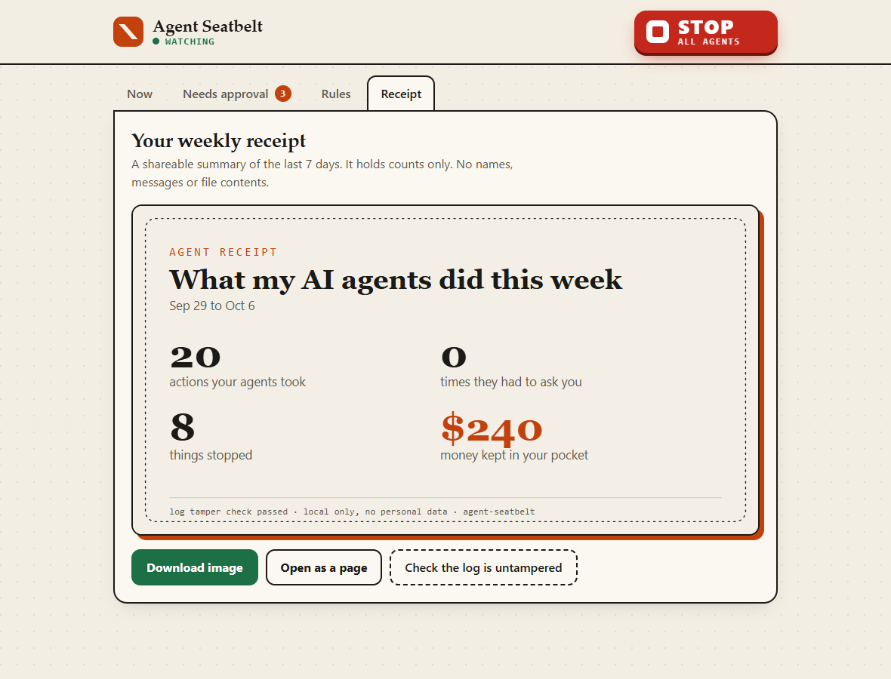
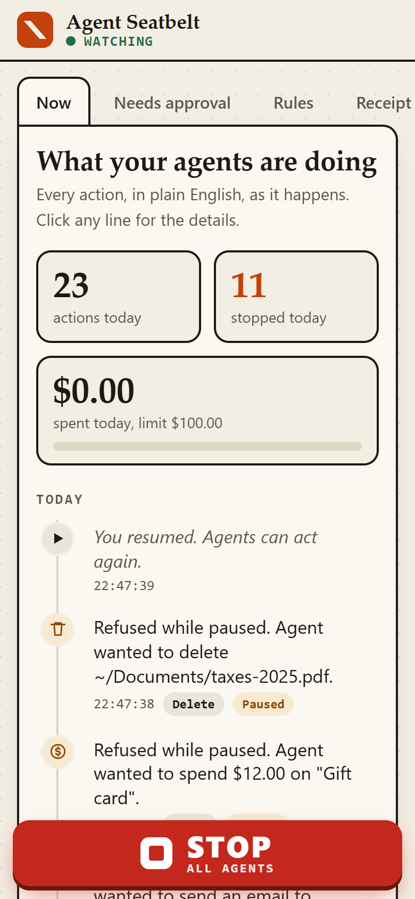
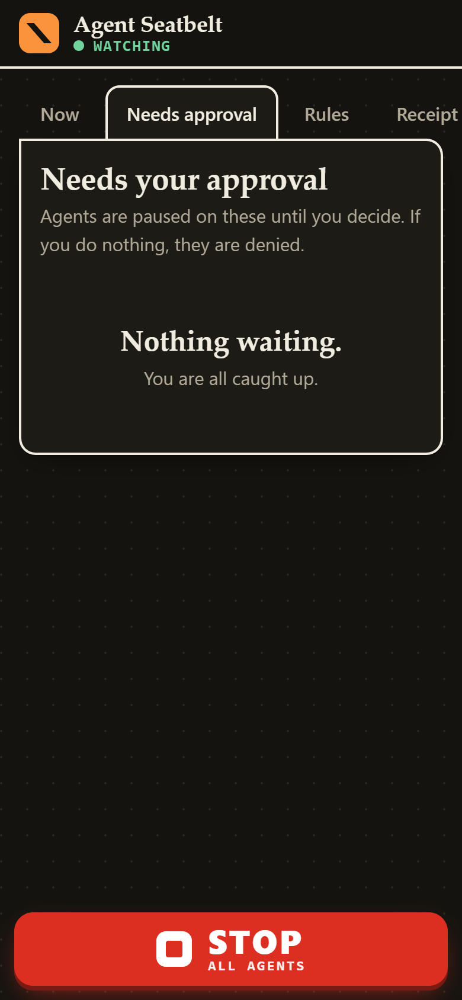
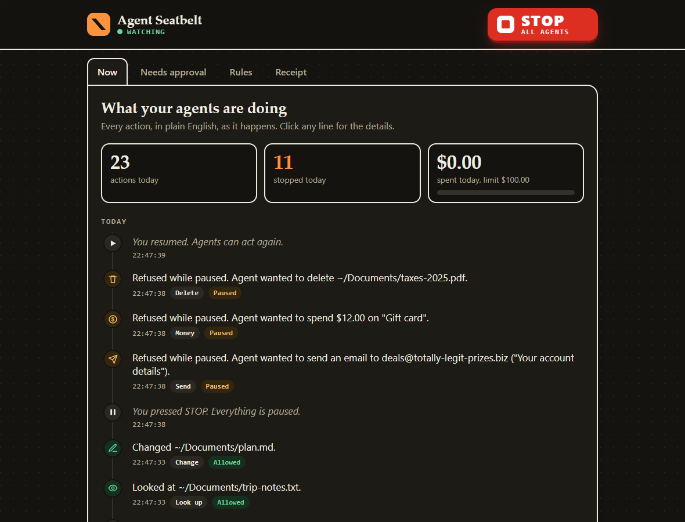

# Agent Seatbelt

[](https://m8ven.ai/mcp/zaydmulani09-agent-seatbelt-n6m0hp?s=readme)

**A seatbelt and a black box for your AI agents.** A local gateway that sits between any MCP agent and its tools: it writes down everything the agent did in plain English, asks before it spends, sends or deletes, caps its spending, and has one big STOP button.

Everything stays on your computer. No accounts, no cloud, no telemetry, no LLM calls.



## Quickstart (30 seconds)

You need Node 22.13 or newer.

```bash
npx -y github:zaydmulani09/agent-seatbelt init
```

That finds your Claude Desktop and Claude Code MCP config, shows you exactly what it will change, saves a backup, and routes every server through the gateway. Restart Claude, then open the dashboard:

```bash
npx -y github:zaydmulani09/agent-seatbelt start --open
```

Want to see it work first? Run a scripted agent that tries to overspend, email strangers, delete files and loop:

```bash
npx -y github:zaydmulani09/agent-seatbelt demo --open
```

Preview without touching anything: `init --dry-run`. Undo any time: `init --undo`.

## What you get

| | |
|---|---|
| **Timeline** | Every tool call as a sentence: "Blocked. Agent wanted to spend $240.00 on "Flight to Lisbon"." Written from templates, so no model and no API key. |
| **Rules** | Pick Strict, Balanced or Relaxed, then flip any category between Allow, Ask me and Block. Spending caps per purchase and per day. Rate limits. Optional regex guards on arguments. |
| **Ask before it acts** | Held calls show up under "Needs approval" with Approve, Deny and "Always allow this". Unanswered for 120 seconds means denied. Clients that support MCP elicitation get asked there too, first answer wins. |
| **Runaway detection** | If an agent makes a burst of calls or repeats one call over and over, everything is paused automatically. |
| **STOP** | One big button. Also `agent-seatbelt stop`, or create a file named `PAUSED` in the config folder. While paused every call is refused and every held question is denied. Resume is one click. |
| **Black box** | Append-only SQLite, every row hash-chained to the one before. Secrets and card numbers are redacted before anything is stored, or store only fingerprints. |
| **Weekly receipt** | A shareable card: actions taken, questions asked, things stopped, money kept in your pocket. Counts only, no personal data. |

<p>


</p>
<p>


</p>
<p>



</p>

## How it works

```
 your agent (Claude Desktop, Claude Code, ...)
        |  MCP over stdio
        v
 agent-seatbelt proxy   <--- policy.yaml, PAUSED flag, blackbox.db (shared on disk)
        |  MCP over stdio or Streamable HTTP
        v
 the real MCP server (files, email, shop, ...)

 agent-seatbelt start   --> dashboard on 127.0.0.1 (reads and writes the same files)
```

Each wrapped server runs its own small proxy. The proxy and the dashboard share state through the config folder, so the STOP button, approvals and spending totals work across all your agents at once. Every call goes through the same steps:

1. **Paused?** Refuse.
2. **Runaway?** Pause everything and refuse.
3. **Classify the tool** as read, write, money, send, delete, exec or unknown. MCP annotations are used when present (`readOnlyHint` is only trusted if the name does not say money, send, delete or exec), otherwise the tool name, input schema and description.
4. **Apply your rules**, then spending caps, then the rate limit, then the category setting.
5. **Allow, ask or deny**, log it, and tell the agent clearly what happened. A refusal is machine readable and says not to retry, split or reword the call.

## Configuration

The config folder is `%APPDATA%/agent-seatbelt` on Windows, `~/Library/Application Support/agent-seatbelt` on macOS and `~/.config/agent-seatbelt` on Linux. Set `SEATBELT_HOME` to move it. The Rules tab edits `policy.yaml`, or edit it by hand:

```yaml
preset: balanced          # strict | balanced | relaxed
classes:                  # allow | ask | deny, per tool category
  read: allow
  write: allow
  money: ask
  send: ask
  delete: ask
  exec: ask
  unknown: ask
spend:
  perCall: 25             # refuse any single purchase above this
  perDay: 100             # refuse once today's total would pass this
  currency: "$"
  amountPath: order.total # where the amount lives in the arguments (default: amount, price, total, cost)
  paths:
    "shop__*": price.value  # per-tool override
rateLimit: { perMinute: 120 }
runaway: { enabled: true, calls: 40, windowSec: 10, repeats: 8 }
approvalTimeoutSec: 120
logArguments: redacted    # or: hash (store only a fingerprint)
classOverrides:           # fix a misclassified tool
  shop__quote: read
rules:                    # first match wins, checked before categories
  - tool: "shell__*"
    action: deny
    arg: { path: command, regex: "rm -rf|sudo" }
    reason: no destructive commands
  - tool: "notes__*"
    action: allow
```

Spending caps and the rate limit still apply to tools you "always allow".

### Several servers behind one gateway

`init` wraps each server separately and keeps tool names unchanged. To merge several servers into one gateway (tools named `server__tool`), put them in `gateway.yaml` and register `agent-seatbelt serve`:

```yaml
upstreams:
  files: { command: npx, args: ["-y", "@modelcontextprotocol/server-filesystem", "/Users/me/Documents"] }
  shop: { url: "https://example.com/mcp", headers: { Authorization: "Bearer ..." } }
```

## Commands

| Command | What it does |
|---|---|
| `init [--dry-run] [--undo] [--local] [--file PATH]` | Wrap (or unwrap) MCP servers in your Claude config, with a diff and a backup |
| `start [--port N] [--open]` | Dashboard on `127.0.0.1`, prints a sign-in link |
| `stop` / `resume` | Kill switch from the terminal |
| `status` | Paused or watching, questions waiting, spend today, log integrity |
| `receipt [--days 7] [--out DIR]` | Write `agent-receipt.svg` and `.html` |
| `demo [--port N] [--open]` | Scripted misbehaving agent |
| `proxy`, `serve` | The gateway itself (what `init` writes into your config) |

## Honest limits

Read [SECURITY.md](SECURITY.md). Short version: Agent Seatbelt only controls what goes through it. It cannot see actions an agent takes outside proxied MCP tools (built-in shell, browser, file access), tool classification is heuristic, and it is not a substitute for spending limits at your bank or provider.

## Development

```bash
git clone https://github.com/zaydmulani09/agent-seatbelt && cd agent-seatbelt
npm install      # builds on install
npm test         # typecheck, build, 70+ unit, integration and security tests
npm run lint
npm run shots    # headless screenshots (needs Chrome or Edge)
```

Design notes and every default I picked: [docs/DECISIONS.md](docs/DECISIONS.md). Prior art and why this exists: [docs/RESEARCH.md](docs/RESEARCH.md).

MIT licensed. Copyright Zayd Mulani.
